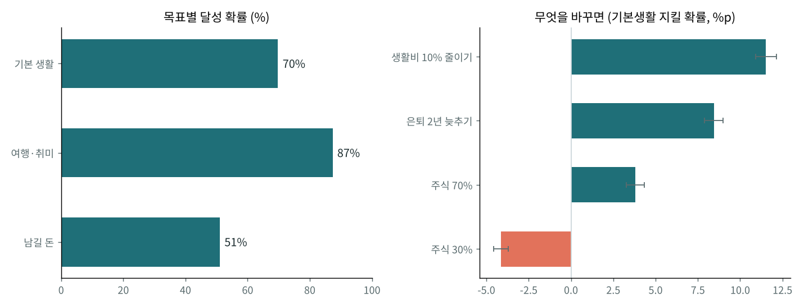
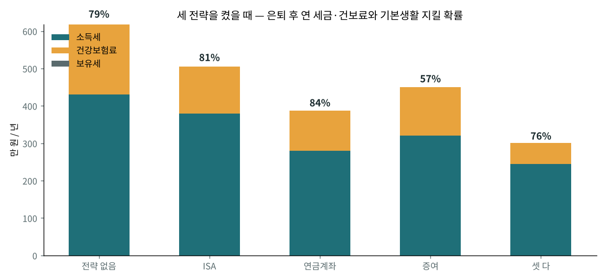
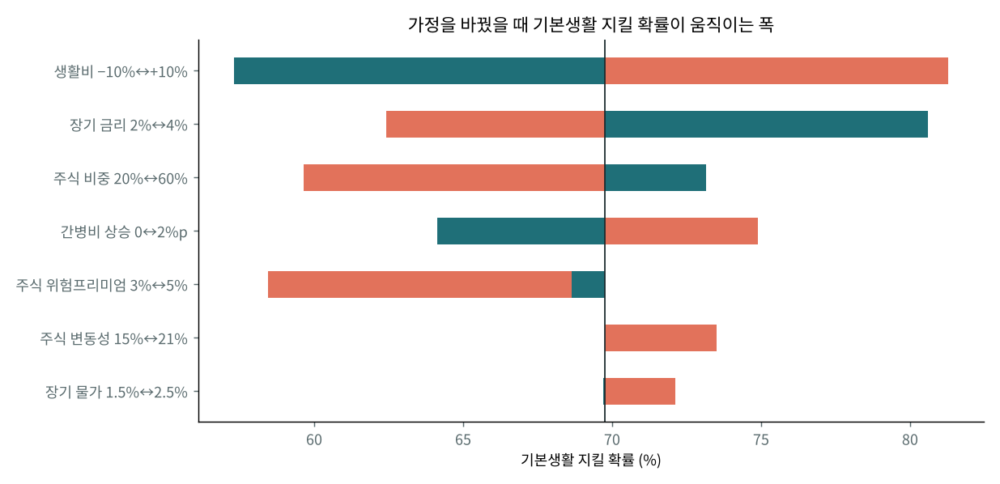

# 노후나침반 — 확률 기반 은퇴 시뮬레이터

> ### 👉 [**지금 바로 써보기 — retire-compass.streamlit.app**](https://retire-compass.streamlit.app)
> 입력 없이 **'예시 가구 보기'** 버튼으로 먼저 결과를 확인할 수 있습니다. 휴대폰으로 아래 QR을 찍어도 열립니다. (한동안 접속이 없으면 처음 열릴 때 "깨우기" 버튼이 나올 수 있어요 — 누르면 30초 안에 열립니다.)
>
> 


**한국어** | [English](README.en.md)

**"얼마를 모았나"가 아니라 "원하는 은퇴생활을 지킬 수 있나"를 묻는, 한국 제도를 반영한 계리 기반 확률 은퇴 시뮬레이터**

기본생활·여행·남길 자산이라는 세 가지 목표를 1만 개의 경제·수명 시나리오 위에서 계산하고, **무엇을 바꾸면 목표에 가까워지는지**를 비교해 보여줍니다. 결과는 추천이 아니라 같은 시나리오 위에서의 비교입니다.

- **웹 앱 (설치 없이 사용):** https://retire-compass.streamlit.app
- **설치형 앱 (안드로이드):** 저장소 [Releases](https://github.com/minyoungkang1227/retirement-simulator/releases)의 `.apk` — 계산 엔진이 앱 안에 있어 인터넷 없이 계산 (`mobile/`)
- **태블릿 앱 (상담용 가벼운 모드):** https://minyoungkang1227.github.io/retirement-simulator/app/ — 홈 화면에 추가하면 앱처럼 열리고, 계산은 기기 안에서 합니다 (`docs/app/`)
- [](https://colab.research.google.com/github/minyoungkang1227/retirement-simulator/blob/main/notebooks/retire_sim_colab.ipynb) (분석용 노트북)

## 왜 만들었나

국내 은퇴 계산기는 대부분 수익률과 수명을 고정한 단순 계산이고, 세금·건강보험료가 빠져 있어 결과가 낙관적입니다. 해외 도구(Boldin, ProjectionLab)는 확률 시뮬레이션을 쓰지만 미국 제도 기준입니다. 이 프로젝트는 **한국 제도 + 확률 모델 + 계리 모델**을 하나로 묶어 그 빈자리를 채웁니다.

## 이렇게 동작합니다

```
① 단계별 입력 (20세부터): 은퇴 시점 → 자산·소득·저축 → 기본생활비 → 여행 예산 → 연금 → 남길 자산 → 투자 성향 → 최종 확인
② 1만 개 시나리오: 금리·물가·주가(연결된 확률과정) × 부부 각자의 수명·간병(다중상태 모델)
③ 현금흐름: 은퇴 전 저축 → 은퇴 후 기본생활비 우선, 여유가 있을 때만 여행 예산 지출
④ 세금·건보료·보유세·상속세 반영
⑤ 결과: Income Gap, 목표별 달성 확률, 필요 금융자산·필요 저축액, "직접 바꿔보기"(은퇴 시기·저축·생활비·국민연금·투자 성향 슬라이더, 변화 곡선, 주택연금·집 줄이기 비교), "상품 추가해 보기"(예금·연금·보험)
```

## 차별점

1. **목표 기반 구조** — 기본생활(지켜야 할 목표), 여행·취미(조정 가능한 목표), 남길 자산을 나누고, 나쁜 시나리오에서는 선택 지출부터 줄이는 가드레일 규칙을 적용 (보호선 = 생존확률 가중 기대 부족분 현가)
2. **한국 제도** — 국민연금 조기·연기수령, 사적연금 1,500만원 분리과세, 금융소득종합과세, 건강보험료(지역/직장, 피부양자), 재산세·종부세, 상속·증여세
3. **계리 모델** — 통계청 2024 완전생명표 + 코호트 사망률 개선(연령별 연간 0.3~2.5%, 통계청 추이로 검증), 부부 공동생존, 간병 다중상태 마르코프(건강 → 경증 → 중증 → 사망, 장기요양 통계로 보정), 연금 상품(종신·부부형·보증기간·체증·거치형) 수지상등 가격, 생명표 사망률 보존 보정
4. **확률 경제 모델** — ECOS 실데이터로 추정한 실질금리·물가 OU 과정과 피셔 연결, 2요인 채권 가격 해석해, 1년 금리 적분의 정확한 결합분포, 폭락 점프, 파라미터 불확실성, 운용보수
5. **통계적으로 정직한 비교** — 공통 난수 위에서 경로별 차이로 신뢰구간을 계산해 "차이 있음 / 없음"을 판정

## 결과 예시 (모델 v50 · 경로 1만 개 · `scripts/readme_numbers.py` 로 재현)

**52·50세 부부, 60세 은퇴, 금융자산 5억, 월 저축 150만 원** (기본생활비 월 300만 원 + 여행 연 1,200만 원, 연금 월 160만 원, 1억 남기기)

- 목표 달성: 기본생활 유지 **53%**, 여행·취미 충족 **70%**, 1억 남기기 **43%**

| 무엇을 바꾸면 | 기본생활 유지 확률 변화 (95% 신뢰구간) |
|---|---|
| 은퇴 2년 늦추기 | **+10.9%p** (±0.6) |
| 생활비 10% 줄이기 | +8.4%p (±0.6) |
| 투자 성향 성장형 (주식 70%) | +5.0%p (±0.5) |
| 월 저축 50만 원 늘리기 | +4.4%p (±0.4) |
| 투자 성향 보수형 (주식 30%) | −13.0%p (±0.7) |

| 위기 상황 | 기본생활 유지 확률 변화 |
|---|---|
| 은퇴 첫해 주가 −40% | −15.9%p |
| 은퇴 10년 뒤 주가 −40% | −10.0%p |
| 3년 연속 물가 6% | −5.0%p |
| 예상보다 오래 삶 (사망률 −20%) | −3.4%p |
| 간병 위험 2배 | **−4.1%p** |

- 이 가구에서는 **은퇴 시점이 가장 강력한 수단**이고, 같은 폭락도 **은퇴 직후**에 올수록 치명적입니다(수익률 순서 위험).
- **가정 범위는 42%~64%입니다.** 주식 위험프리미엄·수명·간병 발생률을 각각 추정 폭만큼 움직인 결과의 최소·최대입니다(v47). 폭은 사실상 **위험프리미엄**이 만듭니다 — 위험프리미엄만 ±1 표준오차(5.2% ± 1.4%p) 움직이면 42%~64%, 수명은 52%~54%, 간병 발생률(±20%)은 52%~54%입니다. 몬테카를로 오차 ±0.7%p는 그 1/15이고, 이 범위는 경로를 늘려도 줄지 않습니다. 그래서 절대값보다 **선택지 간 차이**를 보는 것이 중요합니다.

**20~40대 (30·29세 맞벌이, 연 소득 9,000만 원, 저축률 15%, 퇴직연금 적립, 국민연금 자동 추정)**

- 기본생활 유지 **79%**, 여행·취미 충족 **93%**, 1억 남기기 **74%**
- 무엇을 바꾸면: 월 50만 원 더 저축 +7.8%p · 은퇴 2년 늦추기 +5.9%p · 생활비 10% 줄이기 +5.0%p
- **퇴직연금이 없다면 −25.2%p** — 이 또래에서는 퇴직연금 적립 여부가 다른 어떤 선택보다 큽니다.

**집은 있고 현금은 적은 가구 (65·63세 부부, 금융자산 3억, 집 시세 7억·공시 5억, 기본생활비 월 250만 원 + 여행 연 1,200만 원, 3억 남기기)**

| 주택 활용 | 기본생활 유지 | 여행·취미 충족 | 3억 남길 확률 | 비고 |
|---|---|---|---|---|
| 그대로 | 14% | 35% | 94% | — |
| 주택연금 지금 가입 (63세) | 81% (+67.6%p) | 98% | 70% | 월 165만 원 |
| 주택연금 70세 가입 | 86% (+72.6%p) | 92% | 74% | 월 225만 원 (오늘 가치) |
| 70세에 절반 가격 집으로 이사 | 78% (+63.9%p) | 92% | 87% | 현금 3.5억 확보 |

- 집이 자산의 대부분인 가구는 **집을 활용하느냐가 가장 큰 선택**입니다. 주택연금은 노후 안정성을, 집 줄이기는 상속까지 함께 지키는 쪽으로 맞교환이 갈립니다.
- v45에서 건보료 재산분을 반영하면서 이 가구의 수치가 v44보다 2~5%p 낮아졌고, v47의 지출 경직성 반영으로 다시 5%p 낮아졌습니다(집이 있는 가구일수록 은퇴 후 고정비가 크고, 줄이기 어려운 지출의 영향도 그만큼 큽니다).





## 최근 변경

> **v50.11 (2026-10-27):** **공식 계산기 대조표**를 만들었습니다 — 국민연금공단·건강보험공단·홈택스·복지로·주택금융공사 모의계산기 5곳에 넣을 사례 15개와 모델 값(`retire_sim/official.py`). 받아 온 화면값을 `retire_sim/data/official_checks.csv`에 적으면 앱과 테스트가 바로 대조합니다.
>
> **v50.10 (2026-10-27):** **줄이고 빠르게** — 탭 8개를 5개로(위기 상황·세금은 '바꿔보기' 안 펼침 칸, 설명하기는 '이 계산에 대하여' 안), 겹치던 두 표를 지우고, 무거운 비교는 버튼을 눌러야 계산하게 했습니다. 결과 화면이 끝까지 그려지는 시간 28.5초 → 약 10초(60·58세 예시).
>
> **v50.9 (2026-10-27):** 2단계에 **건강보험 피부양자** 입력을 넣었고(60·58세 예시: 20년 건보료 1,438만 → 718만 원), 바꿔보기 탭에 **'법이 바뀌면?'** — 기초연금 부부감액 축소·폐지, 상속세 일괄공제 확대 같은 논의 중인 개정이 이 가구에 어떤 영향을 주는지 — 를 더했습니다. 확정 전 개정은 기본 결과에 넣지 않습니다.
>
> **v50.8 (2026-10-27):** "이 숫자는 얼마나 확실한가"를 쉬운 말로 다시 쓰고, 수익률 막대를 기본값 그대로 계산해도 "−2%p"가 나오던 문제를 고쳤습니다.
>
> **v50.7 (2026-10-27):** 결과 화면에 **'다른 계산기였다면'** 비교를 넣었습니다 — 같은 입력을 시중 계산기 방식(같은 평균 수익률을 매년 똑같이, 95세까지, 세금·건보료·간병·기초연금 없음)으로도 계산해 나란히 보여주고, 한국 제도를 하나씩 뺐을 때 확률이 얼마나 바뀌는지 표로 보여줍니다. 60·58세 은퇴 부부는 보통 계산기로 "95세까지 1.9억 남음", 노후나침반으로 59%입니다(`retire_sim/contrast.py`).
>
> **v50.6 (2026-10-26):** '얼마가 더 필요할까'를 한 문장(지금 5.0억 → 8.9억이면 10번 중 9번, 3.9억 더)으로 바꾸고, '상품 추가' 탭에서 개별 주식(종목코드)을 뺐습니다.
>
> **v50.5 (2026-10-26):** 결과 화면에서 이해하기 어렵던 두 곳을 고쳤습니다 — '10번 중 9번 지키려면 얼마가 필요할까'(지금 얼마 → 얼마면 되나 한 문장), 돈의 흐름은 '들어오는 돈 = 나가는 돈' 두 줄 막대(한 달 단위). 첫 화면 카드와 입력칸 높이도 맞췄습니다.
>
> **v50.4 (2026-10-26):** **웹 화면을 읽기 쉽게 고쳤습니다** — 버튼·선택 색을 기본 빨강에서 브랜드 청록으로(`.streamlit/config.toml`), 글자 크기를 키우고, 결과 화면을 '결론 → 목표별 → 부족분 → 무엇부터 → 확실성 → 그래프' 순서와 섹션 제목으로 정리했습니다. 모델은 그대로입니다.
>
> **v50.3 (2026-10-26):** **설치형 안드로이드 앱을 만들었습니다** (`mobile/`, Capacitor). 계산 엔진 런타임(약 17MB)을 앱 안에 넣어 첫 실행부터 인터넷 없이 계산하고, `main`에 올리면 GitHub Actions가 APK를 만들어 Releases에 올립니다. iPad·Play 스토어는 개발자 계정이 필요해 다음 단계로 남겼습니다(`mobile/README.md`).
>
> **v50.2 (2026-10-26):** **태블릿 상담 앱(가벼운 모드)을 만들었습니다** (`docs/app/`). 설계사가 태블릿으로 고객 앞에서 1단계 빠른 진단만 빠르게 하도록, 웹 1단계와 같은 질문 5화면 → 결과(10번 중 몇 번 · 은퇴 가능 나이 · 월 부족분 · 가정 범위 · 효과 순위 · 수익률 직접 정해 보기 · 결과 카드)를 담았습니다. **서버 없이 브라우저 안의 파이썬(Pyodide)이 같은 `retire_sim` 엔진을 돌립니다** — 고객 입력이 기기 밖으로 나가지 않고, 한 번 연 뒤에는 인터넷 없이도 됩니다. 같은 입력이면 웹과 계산 ID·확률이 같습니다(1만 경로 1.7초, 서버 0.9초). 화면값 → 엔진 입력 변환은 `retire_sim/lite.py` 한 곳에 두고, 웹 1단계와 한 글자도 다르지 않은지 테스트가 감시합니다. 모델은 그대로(v50). 테스트 163 → 166개.
>
> **v50.1 (2026-10-26):** **검증을 화면으로 꺼냈습니다.** 세금·건보료·퇴직소득세·연금 계산을 법 조문의 세율·공제액·고시값으로 직접 계산한 값과 나란히 둔 **검증 장부**(`retire_sim/verify.py`, 11개 영역 30항목)를 만들고, 앱 '이 계산에 대하여' 탭과 테스트가 **같은 장부**를 읽게 했습니다 — 화면의 "30개 중 30개 일치"는 테스트가 통과하는 한 거짓일 수 없습니다. 고장 네 개를 심어 각각 정확히 그 항목만 잡히는지도 고정했습니다. 공단 모의계산기 화면값과의 대조는 아직이며, 화면에도 그렇게 적었습니다. 테스트 129 → 163개.

> **v50 (2026-10-26):** **세 가지 빈자리를 메웠습니다.** ① **나이에 따른 지출 변화** — 지금까지는 기본생활비와 여행 예산이 평생 같았는데, 실제로는 나이가 들수록 여행·여가는 줄고 의료비는 늘어납니다. 자본시장연구원(2025, 재정패널 2008~2021)에서 60~64세 대비 균등화 실질소비가 75세 이상 43% 수준이고 Blanchett(2014)도 60~90세 연 −1%였지만, 단면 자료에는 '돈이 없어 못 쓰는' 효과가 섞여 있어 보수적으로 **여행·취미만 75세부터 줄어 85세에 절반**을 기본으로 했습니다(기본생활비까지 줄이는 선택, 평생 같게 두는 선택도 있음). 위 예시 가구는 49% → **53%**. ② **은퇴 후 근로**(재취업·파트타임) — 근로소득공제·세액공제, 직장 건보료 본인부담, 기초연금 근로소득 공제까지. 월 200만 원을 65세까지 벌면 +6.6%p, 70세까지면 +11.3%p. 국민연금은 2026년 6월 개정으로 월 약 519만 원 이하 근로면 깎이지 않아 감액하지 않았습니다. ③ **전월세 보증금** — 상속재산, 기초연금 재산, 건보 재산(30%)에 넣습니다. 보증금 5억이면 −10%p인데, 그동안 기초연금을 받는 것으로 잘못 계산하던 것이 바로잡힌 결과입니다.

> **v49 (2026-10-26):** **퇴직금·퇴직연금과 퇴직소득세를 넣었습니다.** 지금까지는 매년 연봉의 1/12이 쌓이는 DC형 하나뿐이었는데, 이제 **DC형과 DB형·퇴직금 제도**(마지막 월급 × 근속연수) 중 고르고 근속연수를 넣습니다(1단계에도 체크 하나와 근속연수). 은퇴 때 IRP로 받아 연금으로 나눠 쓴다고 보고 **퇴직소득세**(근속연수공제 → 환산급여 → 환산급여공제 → 기본세율 × 근속연수/12, 지방세 10%)를 계산하며, 연금수령 1~10년차는 그 70%, 11년차부터 60%만 냅니다. 손검산(1억·근속 10년 = 426.25만 원)을 테스트로 고정했습니다. 52세·연봉 6,000만·근속 20년이면 퇴직금 1.5억, 기본생활 유지 확률 79.0% → **87.7%**. 처음엔 IRP부터 꺼내게 했다가 과세계좌가 불어나 금융소득세·건보료가 늘면서 오히려 −2.4%p가 나와, 인출 순서는 v48과 같게(연금계좌 합쳐 1인당 연 1,500만 원) 두었습니다 — 그러면 v48 대비 차이는 세율뿐(+0.4%p)입니다.

> **v48 (2026-10-26):** **입력을 세 단계로 나눴습니다** — 첫 화면에서 **1단계 빠른 진단**(혼자 3분), **2단계 내 재산 반영**, **3단계 전문가 상담** 중 고릅니다. 묻는 순서는 측정으로 정했습니다: 각 입력을 '기본값으로 때울 때 생길 오차'만큼 움직여 보니 은퇴 나이(33.5%p)·기본생활비(29.7%p)·여행 예산(24.0%p)·금융자산(18.7%p)·투자 성향(18.3%p)·집·대출이 압도적이고, 사별 후 생활비(6.2%p)·부모 간병(2.9%p)·해외주식(1.2%p)은 작습니다. 영향이 크고 누구나 답할 수 있는 것은 1단계, 세금 계산에 필요한 세부는 2단계, 일반인이 답하기 어려운 판단값은 3단계입니다. 묻지 않은 값은 기본값으로 채우고 결과 화면에 무엇을 가정했는지 적습니다. 함께: **이미 갚고 있는 대출**을 넣을 수 있습니다(지금까지는 앞으로 받을 대출만 가능). 은퇴 후까지 남는 상환분만 노후자금에서 나가며, 2억·20년 남은 대출이면 −13.0%p입니다. 대출이 없으면 결과는 v47과 같습니다. 측정표 전체는 [CHANGELOG](CHANGELOG.md)에 있습니다.

> **v47 (2026-10-26):** **지출 경직성을 기본으로 켰습니다.** 형편이 나빠져도 생활 수준을 한 해에 30% 넘게는 못 줄인다는 것은 투자 행동이 아니라 가계 지출의 구조적 성질이라, v36에서 구현해 두고 '행동 가정' 토글에 묶어 꺼 두었던 것을 기본값(`lifestyle_floor=0.30`)으로 돌렸습니다. 8만 경로로 잰 효과는 기본 가구 **−1.3%p**, 60세 은퇴 직후 부부 **−3.0%p**. 위 예시 가구도 다시 돌렸습니다 — 52·50세 부부 52% → **49%**, 집 있고 현금 적은 가구 17% → **12%**(고정비가 이미 큰 가구일수록 영향이 큽니다). 함께: **가정 범위를 위험프리미엄 하나에서 세 요인으로** 넓혔습니다(위험프리미엄 ±1 표준오차, 사망률 수준 ±1σ, 간병 발생률 ±20%를 하나씩 움직인 6개 결과의 최소·최대). 측정해 보니 폭은 **위험프리미엄이 지배**합니다 — v46의 범위가 과소는 아니었지만, 이제 어느 가정이 폭을 만드는지 근거와 함께 말할 수 있습니다. `tax.progressive`·`tax.hi_property_points`를 `searchsorted`로 바꿔 1만 경로 1회가 **0.94초 → 0.78초**(결과는 비트 단위로 동일). `docs/MODEL.md`의 경제·사람 장을 현재 사양으로 통합해 다시 쓰고 참고문헌 20건을 붙였으며, 영문판도 맞췄습니다. 테스트 121 → 122개.

> **v45 (2026-10-20):** 이 모델에 남아 있던 **가장 큰 빈자리**를 메웠습니다 — **지역가입자 재산분 건보료**입니다. 영향이 −7%p 규모인데 기본값이 0이었고, 공단 모의계산값을 손으로 넣지 않으면 조용히 0으로 지나갔습니다. 「국민건강보험법 시행령」 **[별표 4] 재산 60등급 점수표 전체**(1등급 22점 ~ 60등급 2,341점)와 **점수당 금액 211.5원**, **재산 기본공제 1억 원**을 법령 원문에서 넣었습니다. 짝지은 비교로 측정하니 공시 5억 1주택 **45.3% → 38.5%(−6.78%p, 95% CI [−7.27, −6.29])**, 공시 9억 **31.4% → 24.0%(−7.44%p)** — **20년 건보료가 1,500만 원에서 4,100~5,600만 원으로 세 배 가까이** 늘어납니다. 자가 보유 가구의 은퇴 후 고정비를 그만큼 과소평가하고 있었습니다. 등급표·공제액·점수당 금액은 **물가연동되지 않아서**(세법과 같음) 명목 집값이 오르면 등급이 올라갑니다 — 보유세와 같은 조용한 증세가 건보료에도 있습니다. 검증은 점수표 손검산 7개(공제 이하 0점, 1·2등급 경계 450만원, 18등급 439점, 60등급 2,341점 등)와 등급표 형태·물가 비연동·엔진 통합 검정으로 고정했습니다. 함께: 리포트에만 있던 **'은퇴 후 1년 돈의 흐름' 폭포 그래프를 결과 탭으로** 옮기고, 앱과 리포트가 `reporting.money_flow()` 한 곳의 숫자를 쓰는지 테스트가 감시합니다. 집이 없는 기준 가구(69.8%)는 변하지 않습니다. 테스트 108 → 116개.

이전 버전(v1~v49)의 변경 내역과 측정 결과는 [CHANGELOG.md](CHANGELOG.md)에 있습니다.

## 검증

- OU·Vasicek 정확 이산화: 장기 평균·표준편차가 이론값과 일치 (금리 2.99%/1.84% vs 3.00%/1.83%)
- 채권 가격: Vasicek 해석해 0.87706 vs 몬테카를로 0.87723, 2요인 해석해 0.87553 vs 0.87518
- 1년 금리 적분 5×5 결합공분산: 해석해 vs 세밀 시뮬레이션 상관 최대 오차 0.005
- 사망률: 통계청 2024 완전생명표, 모델 기대여명이 공표치와 일치 (0·60·65·80세, 남녀 모두)
- 간병 다중상태 모델에서도 60세 남성 기대여명 보존 (생명표 23.7년 → 23.9년)
- OU 최우추정: 가상 데이터에서 장기 평균·변동성 복원 (회귀 속도는 소표본 과대추정 확인 → 실데이터 추정에서 편의 보정)
- 추정된 모수: 물가 장기평균 2.47%±1.02%p, 실질금리 0.73%±0.74%p, 집값 실질상승 1.25%±1.18%p (원자료와 반영 시점은 [docs/SOURCES.md](docs/SOURCES.md))
- 선택지 비교는 경로별 차이로 신뢰구간 계산 (독립 가정 ±1.38%p → ±0.44%p)
- 결정론적 극한에서 **닫힌식과 일치** (`scripts/benchmark_analytic.py`, 12년 최대 오차 0.0)
- **검증 장부**: 세금·건보료·퇴직소득세·연금 26항목을 법령 손계산·공식 고시값과 대조 — 앱 화면과 테스트가 같은 목록을 읽음 (`retire_sim/verify.py`)
- 테스트 163개를 커밋마다 자동 실행 (대표 가구 결과 범위, 방향성, 이론값, 생명표·간병·주택연금 수치, 루프 밖 순수 함수 단독 검증, 브랜드 필드 도달, 노트북↔모듈 일치)

### 구성요소 영향도 (`scripts/ablate.py`, 하나씩 꺼 보고 짝지은 신뢰구간으로 판정)

기본생활 유지 확률의 변화. `●`는 몬테카를로 오차를 넘은 것(= 진짜 효과), `○`는 오차 안.

| 끈 것 | 60대 부부 | 30대 부부 |
|---|---|---|
| 제도: 기초연금 | ● −25.1%p | ● −4.9%p |
| 간병: 2단계 마르코프 | ● +15.5%p | ● +16.1%p |
| 세금·건보료 전체 | ● +9.8%p | ● +8.0%p |
| 수명: 코호트 개선 | ● +7.2%p | ● +8.9%p |
| 경제: 운용보수 0.5% | ● +6.0%p | ● +6.2%p |
| 경제: 피셔 연결 | ● −5.9%p | ● −5.9%p |
| 간병: 비용 인플레이션 | ● +5.1%p | ● +6.7%p |
| 제도: 유족연금 | ● −3.9%p | ● −4.1%p |
| 경제: 기간프리미엄 | ● −3.3%p | ● −3.3%p |
| 수명: 사별 효과 | ● −0.9%p | ● −0.5%p |
| 경제: 파라미터 불확실성 | ○ +0.2%p | ● +1.3%p |
| 수명: 장수 불확실성 | ○ +0.1%p | ● +1.0%p |
| 경제: 폭락 점프 | ○ +0.0%p | ○ +0.7%p |
| 경제: 금리-주식 상관 | ○ −0.2%p | ○ +0.0%p |

이 재측정에서 버그 하나가 드러났습니다: 세금을 끄는 스위치가 **연금계좌 인출 자체를 막고** 있어, 30대 부부는 퇴직연금이 동결돼 −19.0%p라는 거꾸로 된 값이 나왔습니다. 세금을 켠 기본 경로는 영향이 없어 앱 결과는 그대로지만(비트 단위 동일 확인), 측정값을 믿고 뭔가를 지웠다면 사고가 났을 자리입니다.
`○`인 둘은 꼬리(CTE90)로 다시 재도 유의하지 않지만, 점프의 구간이 [−1.3억, +0.25억]로 넓어 **분해가 안 되는 것**이지 효과가 0인 것이 아니라서 남겼습니다.

세 전략(ISA·연금계좌·증여)은 기본값이 꺼져 있어 **켜서** 측정합니다 — 금융자산 8억·연금계좌 2억 가구에서 ISA +2.2%p, 연금계좌 +4.7%p, 증여(10년마다 자녀당 5천만 원)는 유지확률 −22.7%p이지만 가족 이전 총액 +2.9억으로 **맞교환이 분명**합니다.

## 구조

```
streamlit_app.py     웹 앱 (단계별 입력 → 목표별 결과 → 무엇을 바꾸면)
retire_sim/          모델 패키지
  config.py          입력 스키마 (목표 3단, 적립기, 간병 모델)
  economy_v2.py      금리·물가·주식·채권 시나리오 (피셔 연결, 적분 금리, 점프, 쇼크)
  mortality.py       사망률, 간병 다중상태 마르코프
  engine_tax.py      세금·계좌·부동산·사업소득·목표 가드레일 엔진
  tax.py             한국 세법·건보료 규칙 (기준일 2026-09, 재산분 60등급 점수표 포함)
  pension.py         국민연금·기초연금·유족연금 산식
  product.py         연금보험 상품 (공시이율·사업비·해지공제·연금 전환)
  protection.py      보장설계 (필요보장액: 니즈분석법·생애가치법)
  optimize.py        선택지 탐색 (주식 비중 경로·국민연금 개시 나이·인출 순서)
  calibrate.py       OU 최우추정, ECOS 데이터 연결
  market_data.py     종목코드 → 베타·상관·금리 민감도 추정
  metrics.py         고갈확률, 신뢰구간, 짝지은 비교
  sources.py         외부 자료 출처의 유일한 목록 (docs/SOURCES.md 자동 생성)
  inputs.py          입력 → 엔진 설정 변환과 검증 (앱·API 공용)
  advice.py          선택지 순위, 가정의 폭
  reporting.py       상담 리포트 조립, 돈의 흐름(money_flow)
  report.py          리포트 HTML·SVG 그래프
  session.py         고객 입력 저장·복원, 재현용 계산 ID
  branding.py        화이트라벨 (기관 이름·색·로고)
  api.py             HTTP API (FastAPI) — /simulate, /compare, /report, /product/compare, /usage
  usage.py           API 호출 기록 (종량 집계 · 상담 로그, 고객 입력은 남기지 않음)
  official.py        공식 모의계산기 대조 사례와 모델 값 (받아 온 값은 data/official_checks.csv)
  contrast.py        '다른 계산기였다면' — 시중 계산기 방식(고정 수익률) 계산과 제도를 하나씩 뺀 비교
  lite.py            태블릿 앱 가벼운 모드 — 1단계 화면값 → 엔진 입력, 결과 묶음 (브라우저 안에서 실행)
mobile/              설치형 앱 (Capacitor) — docs/app 화면 + 앱 안에 넣은 엔진 런타임, APK는 .github/workflows/android.yml 이 빌드
docs/app/            태블릿 앱 (PWA: index.html · worker.js · sw.js · engine.zip) — GitHub Pages로 배포
notebooks/           Colab 분석 노트북
scripts/             검증·생성 스크립트
  check.py             작업 후 오류 검증 + 최적화 점검을 한 번에
  benchmark_analytic.py  결정론적 극한에서 닫힌식과 대조
  ablate.py            구성요소 영향도
  error_budget.py      오차 예산
  readme_numbers.py    문서 수치 재계산
  make_readme_images.py  문서 그림 재생성
  make_sources_doc.py  자료 출처 문서 생성
  sync_notebook.py     노트북↔모듈 동기화
  build_app.py         태블릿 앱의 엔진 묶음(docs/app/engine.zip) 다시 만들기 — 엔진을 고치면 꼭 실행
  product_compare.py · product_spread.py   연금보험 상품 비교, 상품 선택 vs 개시 나이
  measure_hi_property.py   건보료 재산분 손계산·짝지은 비교
  calibrate_care.py · calibrate_mortality.py   실데이터 보정
  run_example.py       화면 없이 엔진만 돌려 보기
tests/               회귀 테스트 (pytest, GitHub Actions 자동 실행)
docs/                수식·설계 문서 (MODEL.md / MODEL.en.md), 자료 출처, 결과 그래프
CHANGELOG.md         버전별 변경 내역 (무엇을 / 어떻게 / 전과 무엇이 달라졌나)
```

## 사용법

- **웹 앱:** 위 링크에서 한 단계씩 입력 → "이 조건으로 계산하기"
- **태블릿 앱:** 위 주소를 태블릿 브라우저로 열고 공유 → '홈 화면에 추가'. 처음 한 번 계산 엔진(약 17MB)을 받은 뒤로는 인터넷 없이 열립니다. 배포는 GitHub 저장소 Settings → Pages → Branch `main` · 폴더 `/docs` 한 번만 켜면 됩니다.
- **Colab:** 배지를 누르고 `런타임 > 모두 실행`, 2단계 입력 셀만 수정
- **로컬:**
  ```bash
  pip install -r requirements.txt
  streamlit run streamlit_app.py      # 웹 앱
  python -m pytest -q                 # 이론값 검증 포함 전체 테스트
  python scripts/build_app.py         # 엔진을 고쳤다면 태블릿 앱 묶음도 다시
  cd docs/app && python -m http.server 8000   # 태블릿 앱을 로컬에서 열어 보기 (http://localhost:8000)

  PYTHONPATH=. python scripts/check.py              # 오류 검증 + 최적화 점검 한 번에
  PYTHONPATH=. python scripts/run_example.py        # 화면 없이 엔진만 돌려 보기
  PYTHONPATH=. python scripts/make_readme_images.py # 이 문서의 그림 다시 만들기
  PYTHONPATH=. python scripts/make_sources_doc.py   # 자료 출처 문서 다시 만들기
  ```

## 진행 상황

| 단계 | 상태 |
|---|---|
| 현금흐름 엔진, 부부 사망률, 금리·물가 SDE, 검증 | 완료 |
| 쇼크 테스트, 민감도, 신뢰구간 | 완료 |
| 세금·건보료·보유세·상속증여세·사업소득 (근사) | 완료 |
| 모델 강화 v10 (피셔 연결, 운용보수, 파라미터 불확실성, 폭락 점프, 반대 난수) | 완료 |
| 수리적 보완 v11 (짝지은 신뢰구간, 적분 금리, 간병 다중상태, 기간 프리미엄, OU 최우추정) | 완료 |
| 웹 앱 (Streamlit) | 완료 |
| 목표 기반 재구축 v12 (3단 목표, Income Gap, 적립기, 모델 포트폴리오, 단계별 입력) | 완료 |
| 통계청 2024 완전생명표 반영 (v13) | 완료 |
| 직접 바꿔보기 v22: 조건을 슬라이더로 조합해 전후 비교, 변화 곡선, 숫자 읽는 법 안내 | 완료 |
| 큰 지출 계획 v21: 자녀 교육비·결혼 자금·주택 구입(주담대 원리금균등·전세금 회수·취득세), 은퇴 전 부족분 대출 처리 | 완료 |
| 20~40대 적립기 v20: 소득·저축률·임금상승률, 퇴직연금 적립, 국민연금 자동 추정(2026 개혁), 필요 저축액 역산 | 완료 |
| 계리 심화 v27: 코호트 사망률 개선(Scale MP 방식), CTE70/90·CRRA 확실성등가, 연금 상품 다양화 | 완료 |
| 집값 위험 v26: 한국부동산원 지수로 추정한 확률 집값(평활 보정, 베이즈 실질 상승률), 보유세·주택연금·상속에 반영 | 완료 |
| 주택 활용 v19: 주택연금(한국주택금융공사 2026 월지급금, 대출잔액·비소구·재산세 감면), 집 줄이기(양도세·취득세) | 완료 |
| 주식 수익률 실데이터 v18: KOSPI 변동성·폭락 점프·금리 상관, 위험프리미엄 베이즈 추정 | 완료 |
| 간병 모델 실데이터 v17: 장기요양 인정률·등급 구성으로 보정한 경증·중증 2단계, 2026 본인부담·간병비 시세 | 완료 |
| 기본생활비 보호선 계리화 v16: 생존확률 가중 현가, 연금 개시·부부 생존 상태 반영 | 완료 |
| 상품 추가해 보기 v15: 예금, 종신연금, 간병보험, 정기보험, 연금저축 (종목코드 주식은 v50.6에서 화면에서 뺌) | 완료 |
| ECOS 금리·물가 실데이터 추정 (v14) | 완료 |
| 제도 정밀화 v28·v32·v45: 유족연금, 기초연금 법정 연계감액, 건보료 재산분 60등급 점수표 | 완료 |
| 장수위험·선택지 탐색 v29·v30: 확률적 사망률, 사별 효과, 주식 비중 경로·국민연금 개시 나이·인출 순서 | 완료 |
| 검증·간소화 v31·v37·v44: 해석해 대조, 구성요소 영향도, 세금 함수 손계산 검증 | 완료 |
| 상담 도구화 v33–v35: 세션·재현 ID·2장 리포트·HTTP API·화이트라벨 | 완료 |
| 연금보험 상품 비교 v34·v39: 상품설명서 숫자 그대로, 선택의 폭 vs 개시 나이 | 완료 |
| 간병비 임금 연동·더블케어·행동 가정 v36 | 완료 |
| 출처 단일 목록 v40: 갱신 순서 자동 산출, 설계사용 '설명하기' 탭 | 완료 |
| 보장설계 v42·v43: 니즈분석법·생애가치법, 조건부(사망 시/생존 시) 비교 | 완료 |
| 계좌·가계부 연동, 주기적 재측정 | 예정 |

자세한 변경 내역은 [CHANGELOG.md](CHANGELOG.md), 수식은 [docs/MODEL.md](docs/MODEL.md)를 참고하세요.

## 한계와 주의

- 임시값은 없습니다. 쓰인 자료와 반영 시점은 **[docs/SOURCES.md](docs/SOURCES.md)** 에 한 곳으로 모아 두었습니다(`retire_sim/sources.py` 에서 자동 생성).
- 다만 **주식 위험프리미엄의 추정 오차가 큽니다**(1σ 폭 13.7%p). 절대값 하나를 믿지 말고 **선택지 간 차이**를 보세요 — 그쪽은 같은 난수를 공유해 오차가 훨씬 작습니다(±0.44%p).
- **제도 값은 현행 법령 기준의 고정값**입니다. 법이 바뀔 위험(개정·시행령 변경)은 확률모형 안에 없습니다. 갱신은 출처 목록(`retire_sim/sources.py`)이 시점과 순서를 관리하는 **반자동** 방식이고, 자동 개정 감지는 아직 없습니다.
- 건보료 재산분은 자동차 점수와 월세 환산분을 아직 반영하지 않습니다(전월세 보증금은 v50부터 반영).
- 국민연금을 소득으로 자동 추정할 때 과거 가입기간의 높은 소득대체율·크레딧·부양가족연금은 넣지 않아 **낮게 추정될 수 있습니다**(예상 월액을 직접 넣으면 영향 없음).
- 논의 중인 법 개정(기초연금 부부감액, 상속세 공제 등)은 기본 결과에 넣지 않고 '법이 바뀌면?'에서 따로 비교합니다.
- 세법은 단순화했고 기준일은 2026-09입니다. **투자 추천이나 세무 자문이 아니며**, 실제 결정 전 전문가 확인이 필요합니다.
- 웹 앱의 입력값은 계산에만 쓰이고 저장되지 않습니다.

## 연락처

- 이메일: doongss1@naver.com

## 저작권

© 2026 강민영. All rights reserved. 이용 문의는 이메일로 부탁드립니다. 자세한 내용은 [COPYRIGHT](COPYRIGHT)를 참고하세요.
